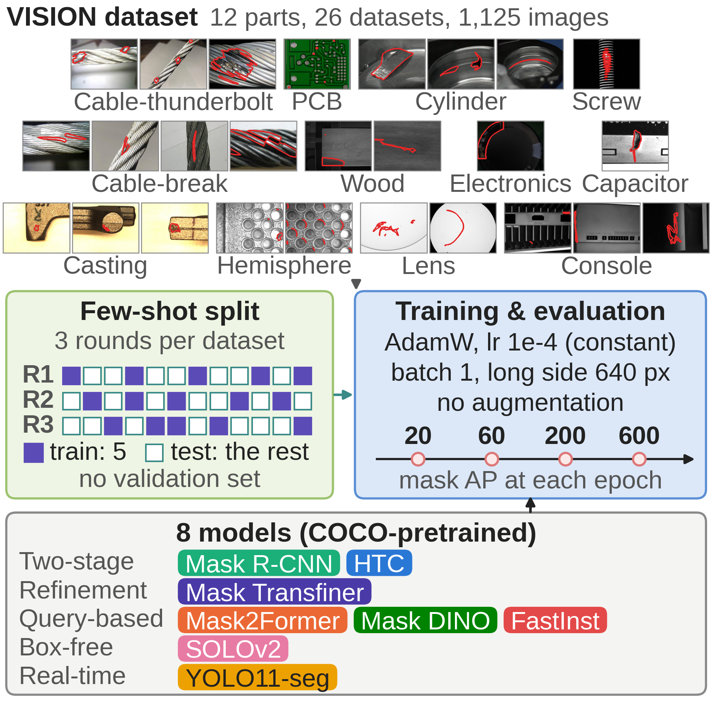
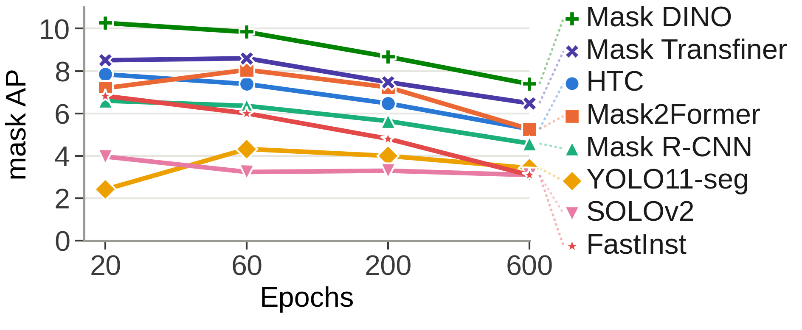
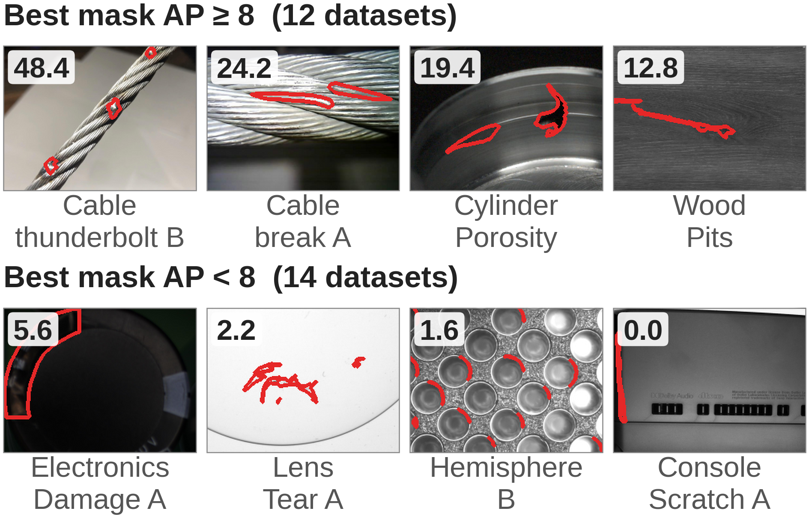

# 소량 데이터 환경의 산업 결함 인스턴스 분할 모델 벤치마크

> 결함 유형당 라벨 이미지 **5장**만으로 학습할 때, 어떤 인스턴스 분할 모델을 얼마나 학습해야 하는가?
> 접근 방식이 다른 **8개 모델**을 산업 결함 **26개 데이터셋**에 같은 조건으로 **624번** 학습·평가해 답을 찾았다.

**논문**: 「소량 데이터 환경에서의 산업 결함 인스턴스 분할 모델 벤치마크」, 2026 한국소프트웨어종합학술대회(KSC2026) 게재 · 포스터 발표
**기간**: 2026.09 – 2026.10 · **저자**: 양진우(1저자), 남승민 · **지도교수**: 안홍렬

---

## 한눈에 보기

| | |
|---|---|
| 문제 | 공장에서는 불량이 드물어 결함 유형마다 라벨이 몇 장뿐이다. 그런데 모델 비교는 대부분 COCO 같은 대규모 데이터에서만 이루어졌다 |
| 데이터 | VISION 벤치마크 → 유사 이미지 제거 → **12종 부품, 26개 데이터셋, 이미지 1,125장, 결함 2,086개** |
| 모델 | 전수 조사 417종 → 후보 22개 실행 시험 → 19개 후보 선별 실험 → 접근 방식별 대표 **8개** |
| 실험 | 8 모델 × 26 데이터셋 × 학습 이미지 조합 3회 = **624회**, 각 600 에폭 (20·60·200·600에서 평가) |
| 결과 | ① 모든 모델이 **20~60 에폭**에서 최고, 600 에폭에서는 21~55% 하락 ② 평균 1위는 **Mask DINO**(약 10.3 mask AP)이지만 1·2위 차이(약 1.7)는 학습 이미지 조합에 따른 변동(약 2.7)보다 작음 ③ 성능은 모델보다 **결함 종류와 크기**에 더 크게 좌우됨 |



---

## 연구 흐름

| 순서 | 연구 | 질문 |
|---|---|---|
| 1 | [생성형 AI 증강 연구](https://github.com/Wlsghdh/VISION-Instance-Seg) (KCC 2026, 공저) | 결함 이미지가 적을 때 **데이터를 어떻게 늘릴까** — 전통 증강 vs 생성형 AI 증강 |
| 2 | Lens 결함 탐색 실험 (개인) | 같은 부품 안에서도 결함과 촬영 구도에 따라 성능이 얼마나 다른가, 해상도는 얼마나 중요한가 |
| 3 | **이 연구** (KSC 2026, 1저자) | 적은 데이터로 **어떤 모델을, 얼마나** 학습해야 할까 |

1탄 이후 Lens 결함으로 혼자 탐색 실험을 해 보니, 같은 부품이라도 결함과 촬영 구도에 따라 성능이 크게 달랐고(구멍 결함 70.0, 찢김 결함 2.6 mask AP), 평가 이미지를 1/8로 줄이면 성능이 절반 가까이 떨어졌다(70.0 → 36.4). 이것이 "모델보다 결함 특성이 중요한가"를 모델 8개, 데이터셋 26개로 확인한 이 연구의 출발점이 됐다.

## 내가 한 일 (양진우)

- **모델 선정 설계** — 비교 범위 기준을 정하고, 전수 조사 417종을 기준에 대어 후보를 좁혔다. Claude와 GPT의 선정안을 교차 검토해 근거를 남겼다. 후보 선별 실험 결과를 바탕으로 "점수 순"이 아니라 **접근 방식별 대표**로 8개를 골랐다.
- **데이터 누수 제거** — 같은 결함을 비슷한 구도로 찍은 사진이 학습/평가로 갈라지면 성능이 부풀려진다. 데이터셋 안의 이미지 쌍 **53,682개**를 유사도로 비교해 묶음 131개를 찾고, 정답 마스크를 겹쳐 보며 직접 판정해 **56장을 제거**했다.
- **실험 파이프라인** — 서로 다른 프레임워크(MMDetection, Detectron2, Ultralytics)의 모델 8개를 같은 데이터 분할과 같은 설정으로 돌리는 실행기를 만들었다. GPU 배분, 실패 시 재시도, 서버 재부팅 후 이어서 돌리기를 넣었다.
- **실험 수행** — 624회 중 Mask DINO, HTC, Mask R-CNN, SOLOv2 (312회)를 담당했다.
- **분석과 논문** — 결과 집계, 그림과 표 제작(matplotlib), 논문 작성.

## 기술

`Python` `PyTorch` `MMDetection` `Detectron2` `Ultralytics YOLO` `pycocotools (COCO mask AP)` `OpenCV` `matplotlib` · V100 GPU 8장(팀 공유) 위에서 멀티 GPU 작업 관리

---

## 1. 데이터

[VISION](https://arxiv.org/abs/2306.07890)은 14종 산업 부품의 결함 이미지와 인스턴스 라벨을 제공한다. 공식 test 분할은 정답이 공개되지 않아, 라벨이 있는 train+val(1,190장)만 썼다.

| 단계 | 내용 | 결과 |
|---|---|---|
| 묶기 | 결함 종류와 촬영 구도가 같은 이미지를 하나의 데이터셋으로 | 27개 데이터셋, 1,190장 |
| 유사 이미지 제거 | 같은 결함을 비슷한 구도로 찍은 사진은 한 장만 남김. 기준: 사진이 같아도 **라벨이 다르면 중복이 아님** | 56장 제거 |
| 작은 데이터셋 제외 | 남은 이미지가 10장 미만인 데이터셋 제외 | **26개 데이터셋, 1,125장** |
| 분할 | 데이터셋마다 5장 학습 / 나머지 전부 평가. 학습 이미지를 바꿔 3회(Round 1~3), **모든 모델에 같은 분할** | 평가 이미지 995장/회 |

## 2. 모델 선정

"왜 이 8개인가"에 답할 수 있도록 단계를 나눴다.

```
전수 조사 417종 ─→ 범위 기준 적용 ─→ 후보 22개 (실행 시험)
   ─→ 후보 선별 실험 19개 (3개 데이터셋, 100~3,000 업데이트)
   ─→ 접근 방식별 대표 8개
```

| 접근 방식 | 모델 | 고른 이유 |
|---|---|---|
| 2단계 | Mask R-CNN, HTC | 기준선 / 2단계 계열 중 선별 실험 최고 |
| 경계 정교화 | Mask Transfiner | 결함은 경계가 중요 |
| 쿼리 기반 | Mask2Former, Mask DINO, FastInst | 대표 / 최신 / 경량 |
| 박스 없는 방식 | SOLOv2 | 위치로 인스턴스를 나누는 계열 대표 |
| 실시간 | YOLO11-seg | 현장에서 가장 널리 쓰임 |

## 3. 실험 설정 (모든 모델 동일)

| 항목 | 값 |
|---|---|
| 초기 가중치 | COCO 사전학습 (YOLO11n, 나머지 ResNet-50) |
| 학습 | 배치 1, 긴 변 640px, AdamW, lr 1e-4 고정, 데이터 증강 없음, 모델별 튜닝 없음 |
| 학습량 | 600 에폭(3,000 업데이트), 20·60·200·600 에폭에서 평가 |
| 평가 | COCO mask AP (IoU 0.50~0.95) |
| 시드 | 하나로 고정 |

## 4. 결과

### 4.1 학습은 짧게 — 모든 모델이 20~60 에폭에서 최고



| 모델 | 20 | 60 | 200 | 600 에폭 | 최고 대비 600 에폭 |
|---|---:|---:|---:|---:|---:|
| Mask DINO | **10.26** | 9.84 | 8.67 | 7.39 | −28% |
| Mask Transfiner | 8.51 | **8.60** | 7.47 | 6.48 | −25% |
| HTC | **7.84** | 7.38 | 6.47 | 5.26 | −33% |
| Mask2Former | 7.19 | **8.05** | 7.23 | 5.26 | −35% |
| FastInst | **6.82** | 6.00 | 4.80 | 3.09 | −55% |
| Mask R-CNN | **6.60** | 6.36 | 5.64 | 4.58 | −31% |
| YOLO11-seg | 2.42 | **4.32** | 4.00 | 3.42 | −21% |
| SOLOv2 | **3.96** | 3.24 | 3.30 | 3.10 | −22% |

_26개 데이터셋 × 3회 평균 mask AP._ 학습 이미지가 5장뿐이라 길게 학습하면 과적합된다. FastInst는 20 에폭에서 5위였지만 600 에폭에서는 최하위였다. **학습량을 하나로 고정한 비교는 일부 모델에 불리할 수 있다.**

### 4.2 모델보다 결함이 더 중요하다

데이터셋별 1위는 Mask DINO가 26개 중 12개로 가장 많았지만, 모든 결함에서 이기는 모델은 없었다. 같은 Cable 부품이라도 thunderbolt 결함은 최고 48.4였지만 break 결함은 최고 2.0~24.2에 그쳤다.



<details>
<summary>데이터셋별 mask AP 전체 (20 에폭, 굵은 글씨 = 데이터셋별 최고)</summary>

| 데이터셋 | Mask DINO | Transfiner | HTC | M2F | Mask R-CNN | FastInst | SOLOv2 | YOLO11 |
|---|---:|---:|---:|---:|---:|---:|---:|---:|
| Cable-thunderbolt-B | 48.3 | 40.0 | **48.4** | 42.0 | 45.3 | 41.1 | 38.1 | 22.9 |
| Cable-thunderbolt-A | 27.6 | 34.2 | **36.5** | 18.3 | 34.1 | 27.5 | 21.3 | 28.3 |
| Cable-thunderbolt-G | **34.3** | 17.8 | 23.0 | 22.7 | 21.7 | 27.9 | 16.2 | 4.6 |
| PCB_1-missing_hole | 24.1 | **24.5** | 19.3 | 7.9 | 8.9 | 13.8 | 0.0 | 0.0 |
| Cable-break-A | **24.2** | 15.7 | 15.9 | 20.8 | 11.6 | 14.3 | 10.2 | 2.1 |
| Cylinder-Porosity | **19.4** | 15.5 | 8.7 | 15.1 | 6.8 | 8.1 | 3.5 | 1.5 |
| Cylinder-RCS | **15.9** | 5.4 | 0.8 | 13.8 | 3.2 | 5.9 | 0.0 | 2.0 |
| Wood-pits | 10.8 | **12.8** | 9.1 | 7.0 | 5.9 | 6.7 | 3.5 | 0.1 |
| Cylinder-Chip | **11.6** | 9.2 | 7.6 | 10.0 | 6.2 | 8.6 | 1.3 | 0.5 |
| Casting-Rechupe-D | **10.1** | 9.1 | 4.4 | 5.9 | 4.7 | 5.0 | 0.6 | 0.0 |
| Screw-defect | **8.6** | 7.2 | 5.9 | 6.0 | 5.2 | 4.1 | 2.0 | 0.1 |
| Wood-impurities | 5.2 | **8.3** | 3.6 | 1.9 | 1.4 | 2.3 | 0.0 | 0.1 |
| Cable-break-C | 4.1 | 3.7 | **5.6** | 3.4 | 4.6 | 2.3 | 1.4 | 0.0 |
| Electronics-damage-A | 4.1 | 4.8 | 3.5 | **5.6** | 3.7 | 3.2 | 3.0 | 0.4 |
| Capacitor | **5.0** | 4.6 | 4.6 | 3.4 | 3.5 | 2.6 | 0.6 | 0.0 |
| Cable-break-D | **4.6** | 0.4 | 0.0 | 0.0 | 0.6 | 0.0 | 0.0 | 0.0 |
| Hemisphere-A+C+D | 1.6 | 1.7 | **2.3** | 0.0 | 1.2 | 1.5 | 0.3 | 0.0 |
| Lens-Tear-A | 1.7 | 2.0 | 0.7 | **2.2** | 0.1 | 0.1 | 0.3 | 0.0 |
| Lens-Tear-B | **2.1** | 0.0 | 0.0 | 0.2 | 0.5 | 0.0 | 0.0 | 0.0 |
| Cable-break-E | 0.1 | **2.0** | **2.0** | 0.7 | 1.1 | 0.3 | 0.6 | 0.0 |
| Hemisphere-B | **1.6** | 0.8 | 1.0 | 0.2 | 0.8 | 0.2 | 0.0 | 0.1 |
| Casting-Inclusoes-A | 0.7 | 1.0 | 0.1 | 0.0 | 0.0 | **1.3** | 0.0 | 0.0 |
| Console-Scratch-B | **1.1** | 0.3 | 0.2 | 0.0 | 0.3 | 0.0 | 0.0 | 0.0 |
| Console-Collision-B | 0.0 | 0.0 | **0.9** | 0.0 | 0.5 | 0.3 | 0.0 | 0.0 |
| Casting-Inclusoes-C-1 | 0.0 | 0.0 | 0.0 | 0.0 | 0.0 | 0.0 | 0.0 | 0.0 |
| Console-Scratch-A | 0.0 | 0.0 | 0.0 | 0.0 | 0.0 | 0.0 | 0.0 | 0.0 |

평가 이미지로 학습량을 고르지 않도록 모든 모델을 20 에폭 값으로 맞췄다.
</details>

### 4.3 작은 결함이 어렵다

긴 변을 640px로 줄이면 결함 폭이 몇 픽셀만 남는 데이터셋이 있다. 축소 후 결함 폭(중앙값)이 12px 미만인 7개 데이터셋의 평균 최고 mask AP는 약 5.5로, 12px 이상인 19개 데이터셋(약 13.2)의 절반에도 못 미쳤다.

## 5. 실무 제안

1. 라벨이 5장 안팎이면 **20~60 에폭으로 짧게** 학습한다.
2. 데이터셋마다 1위가 다르므로, 상위 모델 두세 개를 **대상 결함 이미지로 직접 비교**해 고른다.
3. 축소 후 폭이 몇 픽셀인 결함은 **입력 해상도를 높이거나 이미지를 나누어(타일링)** 처리한다.

---

## 어려웠던 점과 해결

| 문제 | 해결 |
|---|---|
| 같은 결함 사진이 학습과 평가로 갈라져 성능이 부풀려질 위험 | 데이터셋 안 모든 이미지 쌍을 비교하고, 마스크를 겹쳐 보며 직접 판정해 제거 |
| YOLO 라벨은 결함 하나에 다각형 하나만 허용 → 여러 조각으로 나뉜 결함에서 AP가 0 | 학습 라벨에서만 조각을 이어 하나의 다각형으로 만듦 (평가 정답은 그대로) |
| 프레임워크 3종이 섞여 조건이 어긋날 위험 | 데이터 분할, 해상도, 옵티마이저, 평가 코드(pycocotools)를 실행기 한 곳에서 고정해 모든 모델에 똑같이 적용 |
| 공유 서버가 여러 번 재부팅되고 GPU 메모리가 부족 | 끝난 작업을 건너뛰고 이어 돌리는 실행기, 실패 시 자동 재시도, GPU당 작업 하나씩 배치 |
| 모델마다 가장 좋은 에폭을 고르면 평가 데이터를 보고 고르는 셈 | 비교표는 모든 모델 20 에폭으로 통일 |

## 한계

- 시드 하나에서 학습 이미지 조합 3회를 평균했다.
- 입력 해상도와 학습 설정을 모든 모델에 고정했다. 모델별로 튜닝하면 순위가 달라질 수 있다.
- YOLO11-seg는 다른 모델보다 작은 모델(YOLO11n)을 썼다.

## 저장소 구조

```
data/
  simdup_scan.py         이미지 쌍 유사도 1차 후보 (ORB 정합)
  simdup_verify.py       포개서 밝기차·결함 겹침으로 2차 검증
  simdup_cliques.py      모든 쌍이 통과한 장만 한 묶음으로 (완전 연결)
  simdup_groups.py       묶음표·판정용 대조 시트
  simdup_pairsheet.py    판정판 그림 (원본 · 정렬본 · 차이 · 결함 겹침)
  simdup_shortlist.py    판정할 쌍만 골라 판정판 만들기
  build_dedup_dataset.py 판정 결과를 반영한 정제 데이터셋
  prep_main.py           데이터셋 × Round 마다 학습 5장 / 평가 나머지 묶음
runners/
  run_mmdet.py           Mask R-CNN · HTC · Mask2Former · SOLOv2 (+ 선별 실험 모델)
  run_d2.py              Mask DINO · FastInst · Mask Transfiner (+ 선별 실험 모델)
  run_modern.py          YOLO11-seg
  common_eval.py         공통 평가 (pycocotools, COCO mask AP)
driver/
  main_driver.py         624회 실험 관리 (GPU 배분, 재시도, 이어 돌리기)
  collect_main.py        결과 모아 결과표 만들기
analysis/                논문 그림 1~3
results/
  main_results.csv       본 실험 624회 결과 (시점별 mask AP, AP50, 학습 시간, GPU 메모리)
  screening_budget.csv   후보 선별 실험 (19개 모델, 학습량별)
  dedup_groups.csv       유사 이미지 묶음과 판정
  dedup_removed.csv      이미지 1,190장의 남김/제거와 사유
assets/                  README 그림
```

## 재현

**데이터** — VISION 원본 이미지는 포함하지 않는다. [Hugging Face의 VISION-Datasets](https://huggingface.co/datasets/VISION-Workshop/VISION-Datasets)(로그인 후 이용 동의 필요)에서 받아 부품·결함·구도 단위로 묶는다.

**환경** — 프레임워크 충돌 때문에 파이썬 환경을 둘로 나눴다.

| 환경 | 주요 버전 | 쓰는 실행기 |
|---|---|---|
| legacy | Python 3.10, PyTorch 2.1.0 (CUDA 11.8), MMDetection 3.3.0, MMCV 2.1.0, Detectron2 0.6 | `run_mmdet.py`, `run_d2.py` |
| modern | Python 3.12, PyTorch 2.13.0 (CUDA 12.6), Ultralytics 8.4.158 | `run_modern.py` |

외부 구현체는 `third_party/repos/` 아래에 받아 둔다 (코드는 이 저장소에 넣지 않았다).

| 구현체 | 커밋 |
|---|---|
| [open-mmlab/mmdetection](https://github.com/open-mmlab/mmdetection) | 44ebd17 |
| [facebookresearch/detectron2](https://github.com/facebookresearch/detectron2) | a2f4a87 |
| [IDEA-Research/MaskDINO](https://github.com/IDEA-Research/MaskDINO) | 3831d85 |
| [junjiehe96/FastInst](https://github.com/junjiehe96/FastInst) | 4996a61 |
| [SysCV/transfiner](https://github.com/SysCV/transfiner) | 5b61fb5 |

**실행 순서**

```bash
export VISION_UNITS=/path/to/units_raw      # 단위별로 묶은 VISION 원본
export EXP_ROOT=$PWD/workdir                # 중간 산출물이 쌓이는 곳
export PY_LEGACY=/path/to/legacy/bin/python PY_MODERN=/path/to/modern/bin/python

python data/build_dedup_dataset.py --groups results/dedup_groups.csv --out workdir/units_dedup  # 판정 반영
python data/prep_main.py                                           # 학습/평가 묶음
python driver/main_driver.py --who A --gpus 0,1,2,3 --dry-run      # 무엇을 돌릴지 확인
python driver/main_driver.py --who A --gpus 0,1,2,3                # 실행 (끊겨도 같은 명령으로 이어서)
python driver/collect_main.py                                      # results/main_results.csv
python analysis/make_fig2_8pt_short.py                             # 그림
```

## 데이터 출처와 라이선스

- 데이터: H. Bai et al., "VISION Datasets: A Benchmark for Vision-based InduStrial InspectiON," arXiv:2306.07890, 2023.
- VISION의 다각형 라벨은 **CC BY-NC 4.0**, 원본 이미지는 각 출처(Roboflow Universe)의 라이선스를 따른다.
- 이 저장소에는 원본 이미지를 넣지 않았다. README 그림 1과 3에 들어간 작은 사진(결함 부분을 잘라 정답 경계를 그린 것)은 비상업적 설명 용도로만 쓴다.
- 이 저장소의 코드는 [MIT 라이선스](LICENSE)를 따른다. 결과표와 그림은 VISION 데이터에서 나온 것이므로 위 데이터 라이선스(비상업적 이용)를 따른다.

